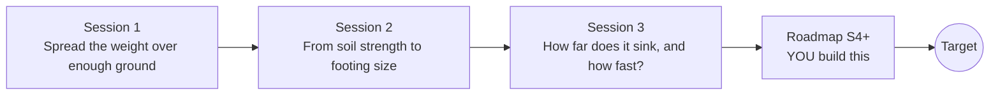

# openfoundation

[](https://github.com/KrunalPanchal1995/openfoundation/actions/workflows/ci.yml)   [](https://colab.research.google.com/github/KrunalPanchal1995/openfoundation/blob/main/sessions/session-01/lesson.ipynb) [](https://krunalpanchal1995.github.io/openfoundation/)

**Choose a footing size from the strength of the soil, in three sessions.**

openfoundation teaches how a building's weight is spread over soil, from pressure under a footing to bearing capacity, settlement and consolidation, using only Python and a browser.

- **Start from a snowshoe.** Session 1 needs only a division: pressure is force over area.
- **See it settle.** Every session ships a slider app that runs in the browser, with labelled graphs.
- **Know you got it right.** Each session ends with a checkpoint that prints PASS or FAIL against hand calculations and closed forms.
- **Build the missing half.** The repo stops at Session 3 on purpose; the roadmap shows the path to the Target.

[Target](#the-target) · [Who is this for](#who-is-this-for) · [Quick start](#quick-start) · [Sessions](#sessions) · [Roadmap](#roadmap) · [Contribute](#contribute) · [Explainer PDF](docs/explainer.pdf)

> **This repo is incomplete on purpose.** Sessions 1 to 3 are here and fully working. The finished Target below is a preview of what the community can build next. We show you the path, not the code. Sessions 4 and up are yours.

## The Target

A square footing under a column is loaded in four equal steps on a clay layer. On the left, the pressure bulb (contour lines of added stress below the footing) swells with each step while the footing sinks, drawn enlarged. Top right, the settlement curve jumps at each load step and then creeps on as water slowly leaves the clay. Bottom right, the consolidation curve shows how far the latest load step has progressed. Your goal over the coming sessions: build this explorer yourself, then add staged loading and neighbouring footings. This is a classroom model, never a design tool.


*Target: a footing loaded in four steps with its pressure bulb, settlement against time and the consolidation curve*


*Target, final load step: bulb contours, settlement curve and consolidation state*


*Target chart: loading in steps delays and smooths the settlement*

Try it live:

- [Math Visual Studio: open playground](https://krunalpanchal1995.github.io/studio/)

How the Target was made is shown only as a path in [promo/roadmap.md](promo/roadmap.md).

## Who is this for
**diploma / undergraduate to advanced undergraduate (levels 5-6).** Topic area: Civil Engineering and Construction.

Prerequisites:

- School algebra, square roots, and the idea of a force and an area.
- Python 3.10 or newer; if `python --version` works, you are ready. PRIMER.md explains the rest.
- No prior GitHub, civil engineering or soil mechanics experience is needed.

New to Python? Read [PRIMER.md](PRIMER.md) first (10 minutes).

## Quick start

No installation knowledge needed. You need [Git](https://git-scm.com/downloads) and [Python 3.10+](https://www.python.org/downloads/) (Windows: tick "Add Python to PATH"). On Mac and Linux type `python3` wherever this page says `python`.

```bash
git clone https://github.com/KrunalPanchal1995/openfoundation.git
cd openfoundation
python start.py 1
```

`start.py` creates a private environment, installs what is needed and runs Session 1 with its checkpoint. Next: `python start.py 2`, `python start.py 3`, or `python start.py test` to check everything. Only a checkpoint: `python start.py check 1`.

Four lines turn the idea of Session 2 into a result (they work as they are): Save it as `try.py` and run it with `python start.py run try.py` (this uses the private environment, where NumPy is installed):

```python
import numpy as np
P, q_allow, t = 600.0, 150.0, 0.6        # column load kN, allowable pressure kPa, footing thickness m
B = np.sqrt(P / (q_allow - 24 * t))      # from q = P / B^2 + 24 t <= q_allow
print(round(B, 3), 'm exact;', round(np.ceil(B / 0.05) * 0.05, 2), 'm built')   # -> 2.104 m exact; 2.15 m built
```

Every session also opens in your browser with sliders (no install): [live apps](https://krunalpanchal1995.github.io/openfoundation/). Or use the Colab badge above for the notebook.

## Sessions

| # | Session | Model level | Time | Live app |
|---|---|---|---|---|
| 1 | [Spread the weight over enough ground](sessions/session-01/README.md) | Level 1: conceptual interactive model | 60 min | [open](https://krunalpanchal1995.github.io/openfoundation/session-01/) |
| 2 | [From soil strength to footing size](sessions/session-02/README.md) | Level 2: mathematical engineering model | 75 min | [open](https://krunalpanchal1995.github.io/openfoundation/session-02/) |
| 3 | [How far does it sink, and how fast?](sessions/session-03/README.md) | Level 3: simulation and validation | 90 min | [open](https://krunalpanchal1995.github.io/openfoundation/session-03/) |

Each session follows the same six steps: A real-world problem, B concept and theory, C visual explanation, D interactive simulation, E worked example and experiment, F assessment and design challenge. Each ends with `checkpoint.py`, which prints `PASS` or `FAIL` against reference numbers. Session 3 also contains the real-world mini-project: **Even settlement for a small building (classroom exercise only)**.

## Architecture



| Folder or file | What is inside |
|---|---|
| `sessions/` | three sessions: README (A-F), `lesson.py`, notebook, live app, exercises, activity sheet, checkpoint |
| `promo/` | the Target: media, live links, and the roadmap (path only) |
| `docs/` | `explainer.tex` and the built `explainer.pdf` |
| `tests/` | runs every lesson and checkpoint headless |
| `start.py` | one command to set up and run anything |
| `QUALITY.md`, `RUBRIC.md` | the quality checklist and the scoring rubric |
| `.github/` | CI, PDF build, Pages deploy, issue and PR templates |

## Roadmap

| Milestone | What you will build | Difficulty |
|---|---|---|
| Session 4: Neighbouring footings and overlapping bulbs | A function giving the added vertical stress at any point (x, y, z) from several rectangular footings. | intermediate |
| Session 5: Staged loading in time | A settlement-time function for a load applied half at time zero and half after one year. | intermediate |
| Session 6: A combined footing for two columns | A search over the width of a 4 m long footing carrying 600 kN and 300 kN columns 3 m apart, each 0.5 m from the nearest end. | intermediate |
| Session 7: Uncertain soil strength | A Monte Carlo run of 200000 samples of a lognormal cohesion with mean 50 kPa and 30 percent coefficient of variation under a strip footing pressure of 114.4 kPa. | advanced |

Full detail with a checkpoint per milestone: [promo/roadmap.md](promo/roadmap.md).

## Contribute
New to GitHub? Read [CONTRIBUTING.md](CONTRIBUTING.md); it starts from zero. Pick an issue labelled `good first issue`. Translations into Hindi, Telugu, Tamil and Malayalam are welcome.

<details>
<summary>Development</summary>

```bash
python start.py test        # runs every lesson and checkpoint
```
Lessons use `# %%` cell markers so they open as notebooks in VS Code. See [QUALITY.md](QUALITY.md) for the standard every session meets.
</details>

## License
MIT. See [LICENSE](LICENSE). Media in `promo/media` is (c) Krunal Panchal, CC BY 4.0.

## Acknowledgments
Part of the [PAN IIT OSS](https://hellofoss.tech-iitb.org/projects) open-source teaching collection, modelled on the structure of [openspline](https://github.com/openspline/openspline). Built on ideas from the Math Visual Studio at https://krunalpanchal1995.github.io/studio/.
