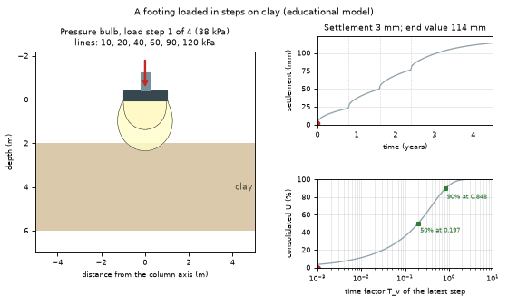
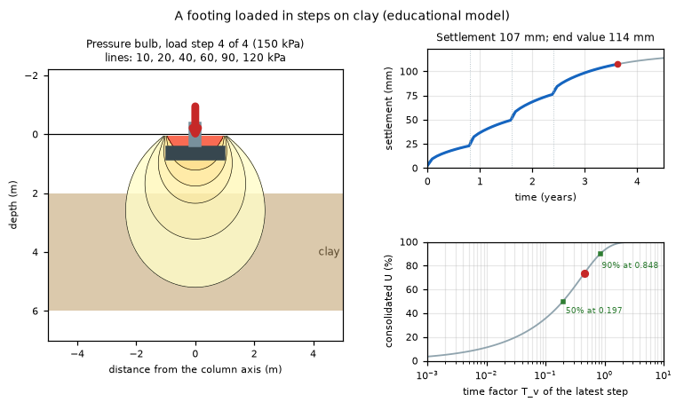
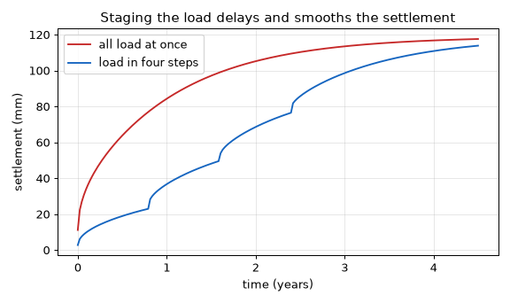

# What you are building toward

A square footing under a column is loaded in four equal steps on a clay layer. On the left, the pressure bulb (contour lines of added stress below the footing) swells with each step while the footing sinks, drawn enlarged. Top right, the settlement curve jumps at each load step and then creeps on as water slowly leaves the clay. Bottom right, the consolidation curve shows how far the latest load step has progressed. Your goal over the coming sessions: build this explorer yourself, then add staged loading and neighbouring footings. This is a classroom model, never a design tool.

*Target: a footing loaded in four steps with its pressure bulb, settlement against time and the consolidation curve*

*Target, final load step: bulb contours, settlement curve and consolidation state*

*Target chart: loading in steps delays and smooths the settlement*

These results come from a private reference build. The code is not published; the roadmap shows the path so you can build your own.

Live links:

- [Math Visual Studio: open playground](https://krunalpanchal1995.github.io/studio/)
