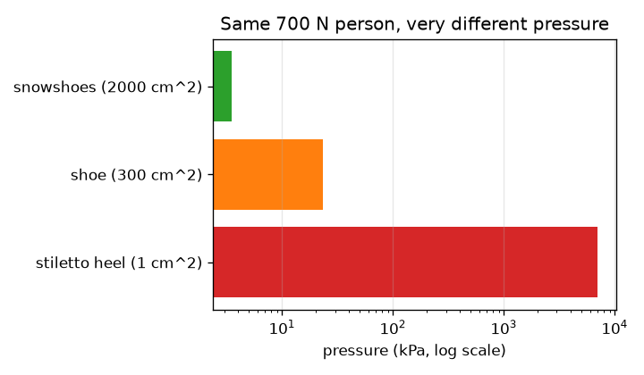
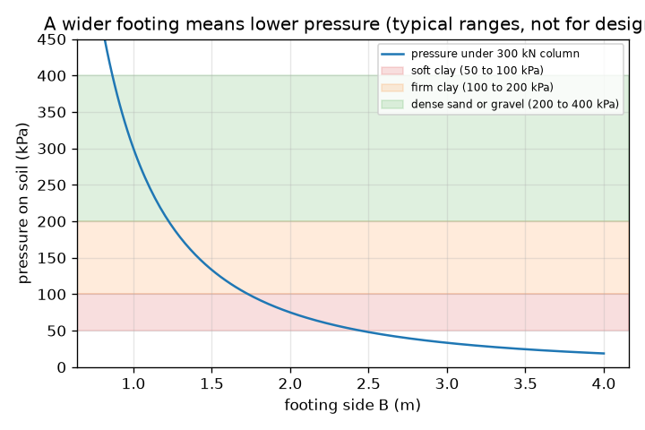

# Session 1: Spread the weight over enough ground

*Level 1 (conceptual interactive model) · about 60 minutes · openfoundation*

> This is a simplified educational model. It is not a validated design tool and must not be used for real structures, electrical installations, vehicles, industrial processes or medical decisions.

**Prerequisites**

- School algebra and square roots.
- You have read PRIMER.md and run `python start.py 1` once.

**Learning objectives.** After this session you can:

- Compute pressure as force divided by area, with kN, m2 and kPa.
- Explain why a stiletto heel and a snowshoe press so differently on the ground.
- Find the smallest square footing for a column load and an allowable soil pressure.
- Read a graph of pressure against footing width.

## A. Real-world problem
A stiletto heel can dent a wooden floor while an elephant does not, and a ten-storey building stands on soil that a heel would sink into. The force is large, so the builder spreads it over a wide footing under each column. If the footing is too small, the soil is overloaded and the building sinks or tilts. How wide must the footing be?

## B. Concept and theory
Pressure is force divided by the area it is spread over. With force in kilonewtons (kN) and area in square metres (m2), the pressure is in kilopascals (kPa); 1 kPa is 1 kN per m2. A column carrying load P sits on a square footing of side B, so the area is B times B and the pressure on the soil is P / B^2. Every soil can carry only so much pressure; the safe value is called the allowable bearing pressure q_allow. Typical textbook ranges are soft clay about 50 to 100 kPa, firm clay 100 to 200 kPa and dense sand or gravel 200 to 400 kPa (rock is much higher). These ranges are only typical teaching values and must never be used for a real design. The footing is safe when P / B^2 is at most q_allow, so the smallest side is B = sqrt(P / q_allow). Doubling the side divides the pressure by four, because area grows with the square of the side.

| Symbol | Meaning | Unit |
|---|---|---|
| P | column load | kN |
| B | side of the square footing | m |
| A | area of the footing, B times B | m2 |
| q | pressure on the soil, P / A | kPa |
| q_allow | allowable bearing pressure of the soil | kPa |

**Assumptions**

- The load is spread evenly over the footing (the column is at the centre).
- The footing's own weight is ignored in this session (Session 2 adds it).
- Allowable pressures are typical textbook ranges, not design values.
- The footing is square and the soil is uniform.

$$ q=\frac{P}{A}=\frac{P}{B^{2}} $$

$$ q\le q_{\mathrm{allow}}\quad\Longrightarrow\quad B\ge\sqrt{\frac{P}{q_{\mathrm{allow}}}} $$

$$ 1\ \mathrm{kPa}=1\ \mathrm{kN/m^{2}} $$

## C. Visual explanation
The first figure plots the pressure under a 300 kN column against footing width, with coloured bands for the typical soft clay, firm clay and dense sand ranges: the curve falls steeply for narrow footings and slowly for wide ones, and it enters the soft clay band only for wide footings. The second figure compares a 700 N person on a stiletto heel (7000 kPa), in shoes (23.3 kPa) and on snowshoes (3.5 kPa) on a log scale: same weight, a thousand-fold difference in pressure.

*The same 700 N person on a heel, a shoe and snowshoes (log scale).*

*Pressure under a 300 kN column against footing width, with typical soil ranges (not for design).*

## D. Interactive simulation
Run the lesson (`python start.py 1`), then open the live app: [Session 1: spread the weight](https://krunalpanchal1995.github.io/openfoundation/session-01/) (or `app.html` in this folder). Move the footing width slider and watch the arrows under the footing grow shorter and turn from red to green once the pressure is below the allowable value; then open the graph view and see the blue curve cross the red allowable line. Change the soil slider and see the smallest side change.

**Challenge.** Carry a column of at least 600 kN on soil with an allowable pressure of at most 150 kPa, using a footing no wider than 2.1 m, and keep the soil safe.

## E. Worked example and experiment
**Problem.** A 300 kN column stands on a 1.5 m square footing. Is that safe on soft clay with an allowable pressure of 75 kPa? If not, what is the smallest square footing, and what size would you build for a 100 kPa soil in 0.05 m steps?

1. Area = 1.5 * 1.5 = 2.25 m2.
2. Pressure q = 300 / 2.25 = 133.3 kPa, which is more than 75 kPa: not safe.
3. Smallest side for 75 kPa: B = sqrt(300 / 75) = sqrt(4) = 2.0 m exactly (pressure 75 kPa, the boundary is allowed).
4. Sanity check: 2.0 m is wider than 1.5 m, as it must be for weaker soil.
5. For 100 kPa: B = sqrt(300 / 100) = 1.732 m, rounded up to 1.75 m (never round down).

**Answer.** 1.5 m is not safe on 75 kPa soil (133.3 kPa). The smallest safe square footing is exactly 2.0 m; on 100 kPa soil build 1.75 m.

**Experiment.** Press a pencil tip and then the flat end of the pencil into soft modelling clay with the same finger force: the tip sinks, the flat end does not. Better, set a small wooden block on damp sand and load it with water bottles, noting how much it sinks for blocks of different width. The model says only the pressure matters, but real soil also settles slowly, is not uniform and its strength changes with water, so the sinking you measure will not follow P / B^2 exactly.

## F. Assessment and design challenge
**Question type A: Conceptual.** Why does a snowshoe stop you sinking even though your weight does not change? What does that say about a building?

Hint

Compare the areas, and think about what soil responds to.

Step-by-step solution

Soil responds to pressure, force per area, not to force alone. A snowshoe spreads the same weight over a much larger area, so the pressure is far smaller (3.5 kPa against 7000 kPa for a stiletto heel in the model). A building does the same with footings: it spreads each column load over enough ground that the pressure stays below what the soil can carry.

**Question type B: Numerical.** A 450 kN column stands on a 1.5 m square footing. Find the pressure, say whether it is safe on firm clay at 150 kPa, and find the smallest safe side.

Hint

Area = B^2, then q = P / A. The smallest side is sqrt(P / q_allow).

Step-by-step solution

q = 450 / 2.25 = 200 kPa, which is above 150 kPa: not safe. Smallest side = sqrt(450 / 150) = sqrt(3) = 1.732 m, so build 1.75 m. Check: 450 / 1.75^2 = 147 kPa, below 150.

**Question type C: Graph and simulation interpretation.** On the pressure-against-width graph for a 300 kN column, what happens to the pressure when the width is halved? Where does the curve cross a 100 kPa soil line?

Hint

Pressure goes as 1 / B^2. Solve 300 / B^2 = 100.

Step-by-step solution

Halving the width makes the area four times smaller, so the pressure becomes four times larger. The curve crosses the 100 kPa line at B = sqrt(300 / 100) = 1.73 m; wider footings are safe, narrower ones are not.

**Question type D: Design and optimisation challenge.** Design: a 300 kN column could stand on soft clay (75 kPa) or on dense sand (300 kPa). Find the smallest square footing for each and compare the concrete area. What other things would an engineer worry about?

Hint

Use B = sqrt(P / q_allow) for each soil and compare B^2.

Step-by-step solution

Soft clay: B = sqrt(300 / 75) = 2.0 m, area 4.0 m2. Dense sand: B = sqrt(300 / 300) = 1.0 m, area 1.0 m2. The footing on clay needs four times the plan area. Trade-off: a wider footing costs more concrete and excavation; an engineer must also check settlement (Session 3), the footing's own weight, groundwater, depth of frost and loads that act off-centre. This model is for teaching only.

Score yourself with [RUBRIC.md](../../RUBRIC.md). Print the [activity sheet](activity_sheet.md) to work on paper.

## Common misconceptions
| Common misconception | What is actually true |
|---|---|
| A heavier building always needs a footing that is proportionally wider. | The area must grow in proportion to the load, but the side only grows as the square root: four times the load needs only twice the side. |
| A big force always means a big pressure. | Pressure is force divided by area; the same force on a larger area gives a smaller pressure (stiletto heel against snowshoe). |
| The allowable pressure is a property of the building. | It is a property of the soil (and its conditions). Weaker soil allows less pressure, so the same building needs wider footings. |
| Round the footing size to the nearest value. | Round up: rounding down leaves the soil slightly overloaded. |

## Glossary
- **pressure**: force divided by the area it acts over; here in kPa
- **kPa**: kilopascal, 1 kN per square metre
- **footing**: the widened base under a column that spreads its load into the soil
- **bearing pressure**: the pressure a footing puts on the soil
- **allowable bearing pressure**: the largest pressure we accept on a soil, including a safety margin

## Finish
1. Do the three coding tasks in [exercises.md](exercises.md).
2. Run `python start.py 1` again after your changes. It ends with the checkpoint; when it prints `PASS`, you are done. (Checkpoint only: `python start.py check 1`.)

Next: [Session 2](../session-02/README.md)
