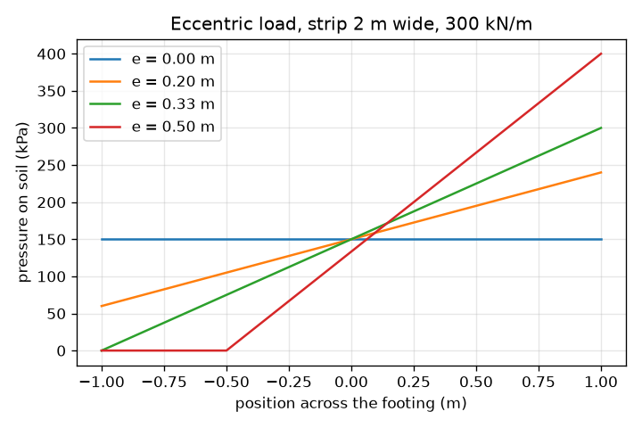
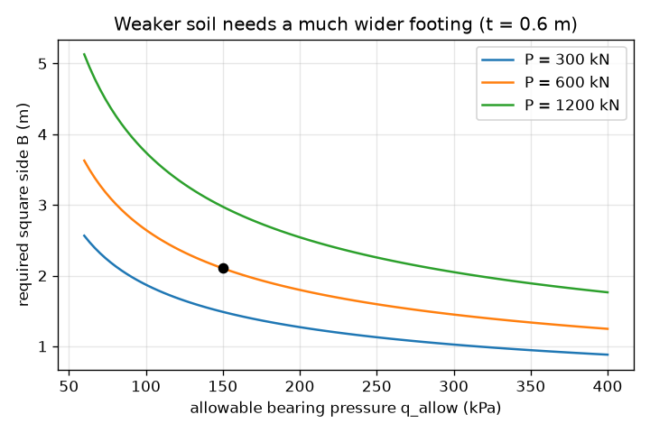

# Session 2: From soil strength to footing size

*Level 2 (mathematical engineering model) · about 75 minutes · openfoundation*

> This is a simplified educational model. It is not a validated design tool and must not be used for real structures, electrical installations, vehicles, industrial processes or medical decisions.

**Prerequisites**

- Session 1: pressure = force / area.
- Square roots and a little algebra.

**Learning objectives.** After this session you can:

- Size a square footing for a column load including the footing's own weight.
- Use Terzaghi's equation to get the ultimate bearing capacity of a strip footing on clay and divide by a factor of safety.
- Apply the middle-third rule to an off-centre load and compute the edge pressures.
- Solve a design problem and say how eccentricity changes the footing size.

## A. Real-world problem
A 600 kN column must stand on soil whose allowable bearing pressure is 150 kPa. The concrete footing itself weighs something, so it presses on the soil too. And where does the allowable pressure come from? Engineers take the pressure at which the soil would fail and divide by a factor of safety. How wide must the footing be, and what if the load is not exactly in the middle?

## B. Concept and theory
The soil carries the column load P plus the footing weight 24 B^2 t (concrete is about 24 kN/m3, t is the footing thickness), so the contact pressure is q = P / B^2 + 24 t. Requiring q at most q_allow gives B = sqrt(P / (q_allow - 24 t)), rounded up. The allowable pressure comes from the ultimate bearing capacity q_ult, the pressure at which the soil shears. Terzaghi's equation for a long strip footing is q_ult = c N_c + q N_q + 0.5 gamma B N_gamma, with c the soil cohesion (kPa), q = gamma D_f the soil pressure beside the footing at its base, gamma the soil unit weight, B the width and N_c, N_q, N_gamma bearing capacity factors that grow with the soil friction angle phi. For saturated clay loaded quickly (phi = 0) the factors are N_c = 5.7, N_q = 1 and N_gamma = 0, so q_ult = 5.7 c + gamma D_f. The allowable pressure is q_ult divided by a factor of safety FS, commonly about 3. For phi above zero the lesson computes N_q and N_c from Terzaghi's formulas; N_gamma needs a table and is not computed here. If the load acts a distance e from the centre of a footing of width B and length L, the edge pressures are P / (B L) times (1 plus or minus 6 e / B). The smaller one reaches zero at e = B / 6 (the middle-third rule): beyond that the soil would have to pull on the footing, so the base lifts off, the contact length is 3 (B / 2 - e) and the largest pressure is 2 P / (3 L (B / 2 - e)).

| Symbol | Meaning | Unit |
|---|---|---|
| P | column load | kN |
| B, L | footing width and length | m |
| t | footing thickness | m |
| q | contact pressure on the soil | kPa |
| c | soil cohesion | kPa |
| gamma | soil unit weight | kN/m3 |
| D_f | depth of the footing base | m |
| N_c, N_q, N_gamma | Terzaghi bearing capacity factors | no unit |
| FS | factor of safety | no unit |
| e | eccentricity of the load from the footing centre | m |

**Assumptions**

- Concrete weighs 24 kN/m3 and the footing is a uniform slab.
- Terzaghi strip-footing equation, general shear failure, uniform soil, no water table effects.
- Only the phi = 0 clay case is evaluated fully (N_c = 5.7, N_q = 1, N_gamma = 0).
- The factor of safety of 3 is a typical textbook choice; the allowable values quoted are not for design.
- Eccentric loads act along one axis of a rectangular footing.

$$ q=\frac{P}{B^{2}}+\gamma_{c}\,t,\qquad B\ge\sqrt{\frac{P}{q_{\mathrm{allow}}-\gamma_{c}\,t}} $$

$$ q_{\mathrm{ult}}=cN_{c}+qN_{q}+\tfrac{1}{2}\gamma BN_{\gamma} $$

$$ \varphi=0:\quad q_{\mathrm{ult}}=5.7\,c+\gamma D_{f},\qquad q_{\mathrm{allow}}=\frac{q_{\mathrm{ult}}}{FS} $$

$$ q_{\max,\min}=\frac{P}{BL}\left(1\pm\frac{6e}{B}\right),\qquad e\le\frac{B}{6}\ \text{for no tension} $$

$$ e>\frac{B}{6}:\quad q_{\max}=\frac{2P}{3L\,(B/2-e)} $$

## C. Visual explanation
The first figure plots the required footing side against the allowable soil pressure for three column loads: the curves rise sharply as the soil gets weaker, and a 600 kN column on 150 kPa soil needs about 2.1 m (dot). The second figure shows the pressure across a 2 m strip under a 300 kN/m load for four eccentricities: at e = 0 the pressure is flat at 150 kPa, at e = 0.2 m it slopes from 60 to 240 kPa, at e = B/6 the small edge just touches zero, and at e = 0.5 m the soil contact shrinks to 1.5 m with a peak of 400 kPa.

*Pressure across a 2 m strip under 300 kN/m for four eccentricities.*

*Required square side against allowable pressure for three column loads (t = 0.6 m).*

## D. Interactive simulation
Run the lesson (`python start.py 2`), then open the live app: [Session 2: size a footing](https://krunalpanchal1995.github.io/openfoundation/session-02/) (or `app.html` in this folder). Set the column load, soil pressure, thickness and footing side. Watch the dashed outline: it is the smallest footing for that soil. Then open the graph view and see how the required side grows when the soil gets weaker.

**Challenge.** Solve the design problem: a 600 kN column on 150 kPa soil with a 0.6 m thick footing. Set the footing side to the smallest value, in steps of 0.05 m, that keeps the soil safe.

## E. Worked example and experiment
**Problem.** Design a square footing for a 600 kN column on soil with allowable pressure 150 kPa, thickness 0.6 m, built in 0.05 m steps. Then find the allowable pressure of a strip footing on clay with c = 50 kPa and FS = 3, and the edge pressures of a 2 m wide strip carrying 300 kN/m with e = 0.2 m.

1. Footing weight per m2 = 24 * 0.6 = 14.4 kPa. The column may use 150 - 14.4 = 135.6 kPa.
2. B = sqrt(600 / 135.6) = 2.104 m, rounded up to 2.15 m. Check: q = 600 / 2.15^2 + 14.4 = 144.2 kPa, below 150. At 2.10 m the pressure would be 150.5 kPa, just too much.
3. Terzaghi, phi = 0: q_ult = 5.7 * 50 = 285 kPa. With FS = 3, q_allow = 285 / 3 = 95 kPa.
4. Eccentric strip: mean pressure = 300 / 2 = 150 kPa; 6 e / B = 6 * 0.2 / 2 = 0.6, so q_max = 150 * 1.6 = 240 kPa and q_min = 150 * 0.4 = 60 kPa. Since e = 0.2 m is below B / 6 = 0.333 m, there is no tension.

**Answer.** Build a 2.15 m square footing (144.2 kPa). The allowable pressure on the c = 50 kPa clay is 95 kPa. The strip's edge pressures are 240 kPa and 60 kPa.

**Experiment.** Load a small block on a tray of damp sand, first at the centre and then off-centre, with water bottles, and look at which edge sinks. Off-centre loading tilts the block as the model says. Real footings differ: soil strength varies from place to place, the footing does not spread load evenly, the factor of safety hides many uncertainties, and a cohesion of exactly 50 kPa is never known exactly. The model is a teaching sketch, not a design method.

## F. Assessment and design challenge
**Question type A: Conceptual.** Why must the eccentricity stay within the middle third (e at most B / 6) for a footing on soil? What happens if it does not?

Hint

Can soil pull on a footing? Look at the smaller edge pressure.

Step-by-step solution

The smaller edge pressure is P / (B L) times (1 - 6 e / B), which reaches zero at e = B / 6. Soil cannot pull on the footing, so beyond that the base lifts off on one side: the contact area shrinks and the largest pressure rises sharply (400 kPa instead of 240 kPa in our example with e = 0.5 m for a 2 m strip), and the footing may tilt.

**Question type B: Numerical.** A strip footing carries 200 kN/m on clay with c = 50 kPa. Using phi = 0, a factor of safety of 3 and ignoring the footing weight, what width is needed? Give the width you would build in 0.05 m steps.

Hint

q_ult = 5.7 c, q_allow = q_ult / 3, then B = load per metre / q_allow.

Step-by-step solution

q_ult = 5.7 * 50 = 285 kPa; q_allow = 95 kPa; B = 200 / 95 = 2.105 m, so build 2.15 m. Check: 200 / 2.15 = 93 kPa, below 95 kPa.

**Question type C: Graph and simulation interpretation.** From the required-width graph, what happens to the footing side for a 600 kN column when the allowable pressure falls from 150 kPa to 75 kPa? Compute it.

Hint

B = sqrt(600 / (q_allow - 14.4)), then round up.

Step-by-step solution

At 150 kPa the side is 2.15 m; at 75 kPa it is sqrt(600 / 60.6) = 3.15 m (rounded up to 3.15 m). Halving the soil strength increases the width by about 46 percent and the area by more than double, because the curve is steep at the weak-soil end.

**Question type D: Design and optimisation challenge.** Design: the 600 kN column in the worked example also carries a moment that makes the load act 0.2 m off-centre in a square footing (t = 0.6 m, 150 kPa allowable including the footing weight). Find the smallest side in 0.05 m steps with e at most B / 6 and a peak pressure no greater than 150 kPa. How much more plan area does the eccentricity cost?

Hint

Peak pressure = P / B^2 * (1 + 6 e / B) + 14.4. Try sides from 2.15 m upward.

Step-by-step solution

Try B = 2.55 m: peak = 600 / 6.5025 * (1 + 1.2 / 2.55) + 14.4 = 150.1 kPa, slightly too high. B = 2.6 m: peak = 144.1 kPa, safe, and e = 0.2 m is below B / 6 = 0.43 m. The plan area is 2.6^2 = 6.76 m2 against 2.15^2 = 4.62 m2: about 46 percent more concrete. Trade-off: reduce the moment (stiffer connection, tie beams) or accept a bigger footing.

Score yourself with [RUBRIC.md](../../RUBRIC.md). Print the [activity sheet](activity_sheet.md) to work on paper.

## Common misconceptions
| Common misconception | What is actually true |
|---|---|
| The allowable bearing pressure is the pressure at which the soil fails. | Failure happens at the ultimate pressure q_ult; the allowable pressure is q_ult divided by a factor of safety (about 3 in our example). |
| A footing's own weight can be ignored. | It adds to the pressure on the soil: 14.4 kPa for 0.6 m of concrete, which changes the required side from 2.0 m (ignoring the weight) to 2.15 m in the worked example. |
| Bearing capacity of clay depends on the footing width. | For phi = 0 and a strip footing the term with N_gamma is zero, so q_ult = 5.7 c does not depend on B (it does for sand). |
| An off-centre load only shifts the pressure a little. | Inside the middle third it makes a straight-line pressure; outside it the base lifts off and the peak pressure jumps. |

## Glossary
- **ultimate bearing capacity**: the pressure at which the soil shears and the footing plunges
- **factor of safety**: ultimate capacity divided by the pressure allowed
- **cohesion**: the part of a clay's shear strength that does not depend on pressure, in kPa
- **eccentricity**: the distance of the load from the centre of the footing
- **middle third**: the central third of the width; a load inside it gives no tension in the soil

## Finish
1. Do the three coding tasks in [exercises.md](exercises.md).
2. Run `python start.py 2` again after your changes. It ends with the checkpoint; when it prints `PASS`, you are done. (Checkpoint only: `python start.py check 2`.)

Next: [Session 3](../session-03/README.md)
