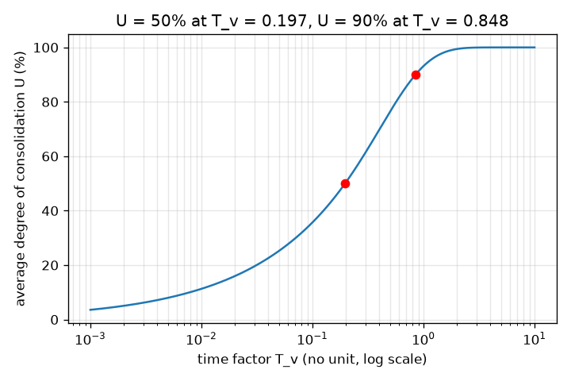
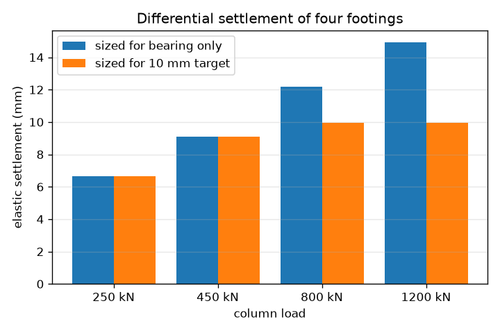
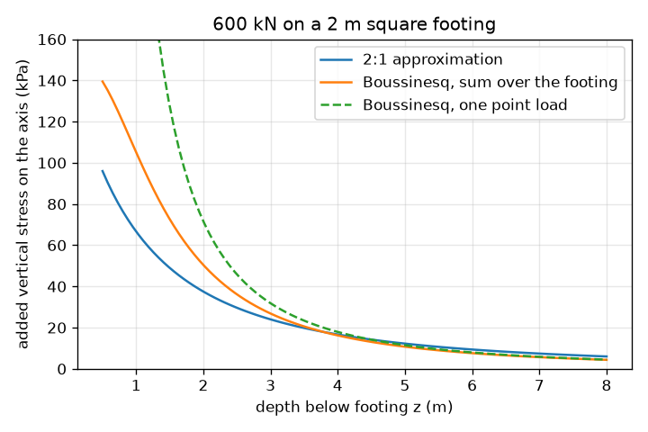

# Session 3: How far does it sink, and how fast?

*Level 3 (simulation and validation) · about 90 minutes · openfoundation*

> This is a simplified educational model. It is not a validated design tool and must not be used for real structures, electrical installations, vehicles, industrial processes or medical decisions.

**Prerequisites**

- Session 1: pressure under a footing.
- Session 2: contact pressure and bearing capacity.
- Logarithms (log base 10) and the exponential function.

**Learning objectives.** After this session you can:

- Compute the immediate elastic settlement of a footing with an influence factor.
- Compute the final settlement of a clay layer and the time curve of consolidation, and check U = 50 and 90 percent against the series.
- Compare the 2:1 spread with Boussinesq stress, and validate the numerics against closed forms.
- Choose footing sizes for a small building so that settlement is even.

## A. Real-world problem
A footing can be strong enough and still sink too far, or sink more under one column than under its neighbour, which cracks walls. Settlement has two parts: an immediate elastic part, and in clay a slow squeezing-out of water called consolidation that can take years. How much will a 600 kN column sink, how long will it take, and how do you size the footings of a building so that it settles evenly?

## B. Concept and theory
Elastic settlement. Treat the soil as an elastic half-space with Young's modulus E and Poisson's ratio nu. A footing of width B carrying pressure q settles s = q B (1 - nu^2) I / E, where I is an influence factor depending on shape and stiffness. We choose I = 0.82 for a rigid square footing (a textbook value); the checkpoint brackets it between the rigid circle (pi / 4 = 0.785) and the average of a uniformly loaded flexible square (about 0.95, centre 1.122). For the same pressure a wider footing settles more; for the same load a wider footing settles less, s = k P / B. Consolidation. A saturated clay layer of thickness H, compression index Cc, initial void ratio e0 and initial effective stress sigma0 (at mid-layer) squeezes under an added stress dsigma by s = H Cc / (1 + e0) log10((sigma0 + dsigma) / sigma0). Terzaghi's theory gives the time: the time factor T_v = c_v t / H_dr^2 (c_v coefficient of consolidation, H_dr the longest drainage path) and the average degree of consolidation U = 1 - sum of 2 / M^2 exp(-M^2 T_v) with M = (2m + 1) pi / 2. It gives U = 50 percent at T_v = 0.197 and U = 90 percent at T_v = 0.848. Stress with depth. The 2:1 rule (an approximation) spreads the load at 2 vertical to 1 horizontal, so a square footing P of side B gives P / (B + z)^2 at depth z. Boussinesq's elastic solution for a point load gives 3 P / (2 pi z^2) on its axis, and in general 3 P z^3 / (2 pi R^5); summing it over the footing area gives the stress under a real footing. Failure cases are bearing failure (pressure above q_ult / FS) and differential settlement between neighbouring columns.

| Symbol | Meaning | Unit |
|---|---|---|
| q | pressure on the soil | kPa |
| B | footing width | m |
| E, nu | Young's modulus and Poisson's ratio of the soil | kPa, no unit |
| I | influence factor (0.82 chosen for a rigid square footing) | no unit |
| H, Cc, e0 | clay thickness, compression index, initial void ratio | m, no unit, no unit |
| sigma0, dsigma | initial effective stress and added stress at mid-layer | kPa |
| c_v, H_dr, t | coefficient of consolidation, drainage path, time | m2/year, m, year |
| T_v, U | time factor and average degree of consolidation | no unit |
| z, P | depth below the footing and load | m, kN |

**Assumptions**

- Elastic settlement of a uniform, linear-elastic half-space under a rigid square footing (I = 0.82 chosen).
- One-dimensional consolidation of a saturated clay layer drained at the top and bottom (double drainage).
- The 2:1 rule is an approximation; Boussinesq assumes an elastic half-space.
- The clay example uses assumed values: Cc 0.3, e0 0.9, effective unit weight 9 kN/m3, footing base 1 m below ground, clay top 2 m below the footing.
- Footings do not influence each other; settlement is the elastic part only in the mini-project.
- All values are classroom numbers and never for design.

$$ s=\frac{q\,B\,(1-\nu^{2})\,I}{E} $$

$$ s_{c}=\frac{H\,C_{c}}{1+e_{0}}\log_{10}\frac{\sigma_{0}+\Delta\sigma}{\sigma_{0}} $$

$$ T_{v}=\frac{c_{v}\,t}{H_{dr}^{2}},\qquad U=1-\sum_{m=0}^{\infty}\frac{2}{M^{2}}e^{-M^{2}T_{v}},\quad M=\frac{(2m+1)\pi}{2} $$

$$ \Delta\sigma_{2:1}=\frac{P}{(B+z)^{2}},\qquad \Delta\sigma_{z}=\frac{3P}{2\pi z^{2}}\ \text{(point load, on the axis)} $$

$$ \Delta\sigma_{z}=\frac{3Pz^{3}}{2\pi R^{5}},\qquad R^{2}=x^{2}+y^{2}+z^{2} $$

## C. Visual explanation
The first figure compares the stress on the axis under a 600 kN, 2 m square footing: the 2:1 curve lies below the Boussinesq sum over the footing (24.0 against 26.8 kPa at 3 m depth, about 11 percent low), and the single point load curve (31.8 kPa at 3 m) overshoots near the footing because the real load is spread. The second figure is the consolidation curve: U climbs with the logarithm of time and passes 50 percent at T_v = 0.197 and 90 percent at T_v = 0.848. The third figure shows four footings sized for bearing only (settlements from 6.7 to 14.9 mm) against a layout sized for a 10 mm target.

*Average degree of consolidation against time factor: 50 percent at 0.197, 90 percent at 0.848.*

*Settlements of four footings sized for bearing only and for a 10 mm target.*

*Stress on the axis under a 600 kN, 2 m square footing: 2:1 against Boussinesq.*

## D. Interactive simulation
Run the lesson (`python start.py 3`), then open the live app: [Session 3: settlement and consolidation](https://krunalpanchal1995.github.io/openfoundation/session-03/) (or `app.html` in this folder). Open the section view to see the clay layer and the 2:1 lines, then the stress view to compare the three stress curves, then the time view to see the consolidation settlement and its 50 and 90 percent points. Change the load, the footing width, the drainage path and c_v and watch the numbers.

**Challenge.** Keep the final consolidation settlement of the clay at or below 60 mm and reach 90 percent consolidation within one year, for a 600 kN column.

## E. Worked example and experiment
**Problem.** A 2 m square rigid footing carries 150 kPa on soil with E = 20 MPa and nu = 0.3. Below it a 4 m clay layer (Cc 0.3, e0 0.9) has sigma0 = 100 kPa and dsigma = 50 kPa at mid-layer, c_v = 1.5 m2/year and drains at top and bottom (H_dr = 2 m). Find the elastic settlement, the consolidation settlement, the total, and the times for 50 and 90 percent consolidation.

1. Elastic: s = 150 * 2 * (1 - 0.3^2) * 0.82 / 20000 = 150 * 2 * 0.91 * 0.82 / 20000 = 0.0112 m = 11.2 mm.
2. Consolidation: s_c = 4 * 0.3 / 1.9 * log10(150 / 100) = 0.6316 * 0.1761 = 0.1112 m = 111.2 mm.
3. Total = 11.2 + 111.2 = 122.4 mm.
4. Time: t = T_v H_dr^2 / c_v. For 50 percent, T_v = 0.197: t50 = 0.197 * 4 / 1.5 = 0.52 years.
5. For 90 percent, T_v = 0.848: t90 = 0.848 * 4 / 1.5 = 2.26 years. Doubling the drainage path would make this 4 times longer.

**Answer.** Elastic 11.2 mm, consolidation 111.2 mm, total 122.4 mm; 50 percent of the consolidation takes 0.52 years and 90 percent takes 2.26 years.

**Experiment.** Squeeze a wet sponge under a flat weight in a tray: it drops a little at once (elastic) and then slowly as water escapes, much faster if you drill extra holes (shorter drainage path). Measure with a ruler against time. The real soil differs: the clay is layered, c_v changes as it compresses, the load spreads, secondary compression continues after consolidation and the soil properties are never known exactly. Treat the numbers as sketches.

## Real-world application and mini-project: Even settlement for a small building (classroom exercise only)
A small building has four columns carrying 250, 450, 800 and 1200 kN on soil with an allowable pressure of 150 kPa and an elastic modulus E = 20 MPa (Poisson ratio 0.3, footing thickness 0.6 m, rigid square footings with I = 0.82). If each footing is sized only for bearing, the settlements differ by 8.26 mm, which can crack walls. Use `design_for_target` and `settlements` from Session 3 and scan target settlements from 6.0 mm to 20.0 mm in steps of 0.5 mm. Your classroom limit is a differential settlement of at most 4 mm. Find the target with the smallest total footing plan area that meets the limit. This is a teaching exercise: real design also needs the footing interaction, consolidation, groundwater, structural stiffness and a qualified engineer.

**Deliverable:** A script that prints, for each target from 6.0 to 20.0 mm, the four footing sides, the differential settlement and the total plan area, names the best target, and saves a bar chart of the four settlements for the bearing-only layout and for your layout.

**Success looks like:** The best target is 10.5 mm, with sides 1.40, 1.85, 2.85 and 4.30 m, a differential settlement of 3.81 mm and a total plan area of 32.0 m2 (the bearing-only layout has 20.4 m2 and 8.26 mm).

## F. Assessment and design challenge
**Question type A: Conceptual.** Why does consolidation take years in clay, and why does halving the drainage path make it much faster?

Hint

Water must flow through very small pores. Look at H_dr in T_v.

Step-by-step solution

The load is first carried by the water in the pores; the settlement happens only as that water flows out through tiny pores, which clay allows very slowly (small c_v). Time is proportional to H_dr^2, so halving the drainage path makes consolidation four times faster (a doubled path makes it four times slower).

**Question type B: Numerical.** A clay layer 3 m thick (Cc 0.3, e0 0.9) has sigma0 = 100 kPa and dsigma = 50 kPa at mid-layer. Find the final consolidation settlement.

Hint

s = H Cc / (1 + e0) log10((sigma0 + dsigma) / sigma0).

Step-by-step solution

s = 3 * 0.3 / 1.9 * log10(1.5) = 0.4737 * 0.1761 = 0.0834 m = 83.4 mm. Sanity check: 3/4 of the 4 m layer's 111.2 mm = 83.4 mm, as it must be since settlement is proportional to the thickness.

**Question type C: Graph and simulation interpretation.** On the consolidation curve with c_v = 1.5 m2/year and H_dr = 2 m, at what times are 50 and 90 percent of the settlement reached?

Hint

t = T_v H_dr^2 / c_v with T_v = 0.197 and 0.848.

Step-by-step solution

t50 = 0.197 * 4 / 1.5 = 0.52 years and t90 = 0.848 * 4 / 1.5 = 2.26 years. The curve is steep early (half the settlement in about 6 months) and then flattens, so the last 10 percent takes far longer than the first 50.

**Question type D: Design and optimisation challenge.** Design: two columns carry 250 kN and 1200 kN. The bearing-only footings are 1.40 m and 3.00 m (settlements 6.7 and 14.9 mm). With E = 20 MPa and nu = 0.3, find the smallest width for the big footing in 0.05 m steps so that the two settlements differ by at most 3.5 mm. What does it cost?

Hint

s = k P / B with k = 0.91 * 0.82 / 20000. The big footing may settle at most 3.5 mm more than the small one.

Step-by-step solution

The small footing settles 6.66 mm. The big one may settle up to 10.16 mm: B >= k * 1200 / 0.0101625 = 4.406 m, so build 4.45 m (settlement 10.06 mm, difference 3.4 mm; 4.40 m would give 3.51 mm, just too much). Cost: its plan area grows from 9.0 m2 to 19.8 m2, more than double the concrete, to save about 5 mm of differential settlement. Trade-off: size, cost and the tolerance of the building.

Score yourself with [RUBRIC.md](../../RUBRIC.md). Print the [activity sheet](activity_sheet.md) to work on paper.

## Common misconceptions
| Common misconception | What is actually true |
|---|---|
| If the footing is safe against bearing failure, settlement does not matter. | A footing can pass the bearing check and still settle too much or unevenly; both checks are needed. |
| Consolidation settlement happens immediately. | It follows the time curve: 50 percent after T_v = 0.197 and 90 percent after T_v = 0.848, which can be years in clay. |
| The 2:1 rule is exact. | It is a quick approximation: here it is about 11 percent below the Boussinesq sum at 3 m depth under the centre. |
| Equal footing pressure gives equal settlement. | For the same pressure a wider footing settles more (s is proportional to q B), so equal pressure on unequal columns gives differential settlement. |

## Glossary
- **settlement**: the downward movement of a footing as the soil compresses
- **consolidation**: the slow compression of a saturated clay as water leaves its pores
- **degree of consolidation**: the fraction of the final consolidation settlement that has happened, U
- **Boussinesq**: the elastic solution for the stress below a point load on the ground surface
- **differential settlement**: the difference in settlement between two parts of a structure

## Finish
1. Do the three coding tasks in [exercises.md](exercises.md).
2. Run `python start.py 3` again after your changes. It ends with the checkpoint; when it prints `PASS`, you are done. (Checkpoint only: `python start.py check 3`.)

Next: the [roadmap](../../promo/roadmap.md). Session 4 is yours to build.
